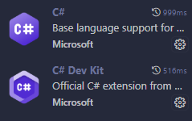

"# simpleTextEditor" 



## اجرا

ترمینال را در پوشهٔ پروژه باز کنید و دستور زیر را اجرا کنید:

```bash
dotnet run
```


## رفع مشکلات

### خطای `dotnet: command not found` یا `dotnet is not recognized`

یعنی .NET SDK نصب نیست یا ترمینال بعد از نصب دوباره باز نشده است.

1. [.NET SDK](https://dl2.soft98.ir/soft/n/NET.10.0.SDK.v10.0.402.x64.rar?1792833695) را نصب کنید.
2. ترمینال را ببندید و دوباره باز کنید.
3. برای بررسی نصب، این دستور را اجرا کنید:

```bash
dotnet --version
```

### خطای پیدا نشدن فایل پروژه

مطمئن شوید ترمینال در پوشه‌ای باز شده که فایل `NotepadClone.csproj` داخل آن است، سپس اجرا کنید:

```bash
dotnet run
```
